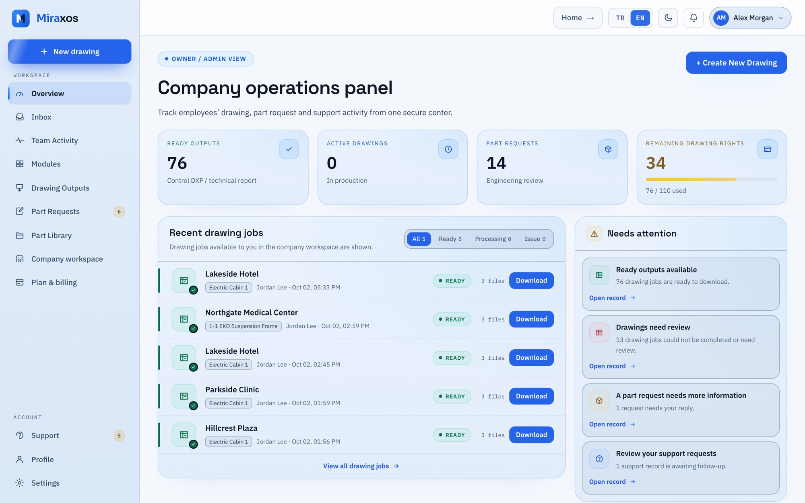
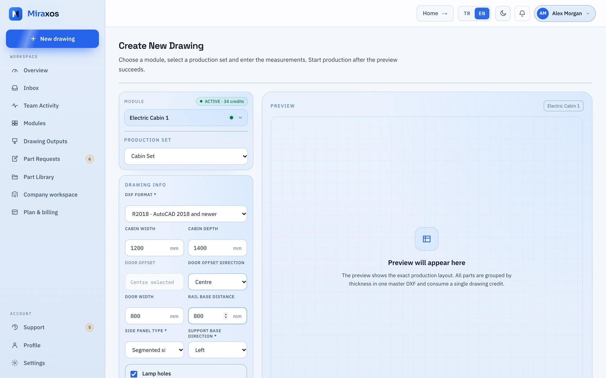
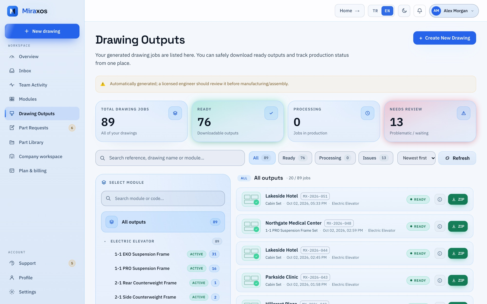
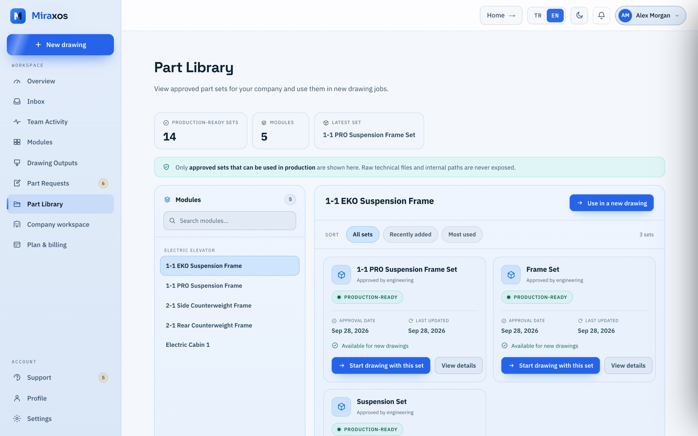
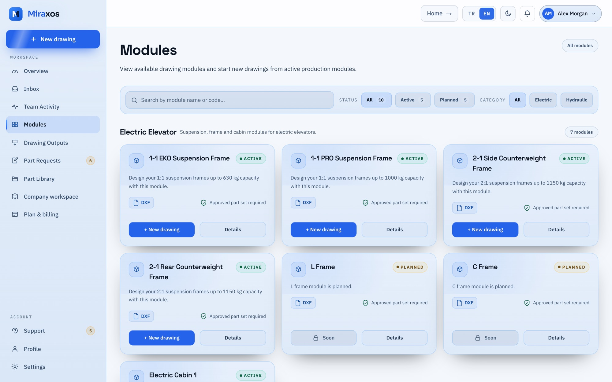
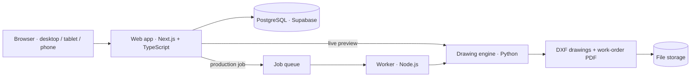

  

  
  
  
  

# Miraxos

**Miraxos turns one set of elevator cabin dimensions into a complete, production-ready drawing package**: laser-ready DXF
part files and a work order, in minutes, from the browser.

It is a commercial B2B SaaS, live at **[miraxos.com](https://miraxos.com)** and used in production by elevator manufacturers
in Türkiye.

> This repository is a case study. Miraxos is closed source; there is no code here.

---

## 🏭 The problem

Elevator manufacturing is made to order. Every building has its own shaft, so every order needs its own cabin and car frame,
and every one of those is dozens to hundreds of sheet-metal parts that have to be drawn, dimensioned and sent to the laser.

Most manufacturers still do this by hand in CAD, order after order. It is slow, it ties up skilled engineers with repetitive
work, and a single wrong dimension can go unnoticed until the steel is already cut.

## 💡 The solution

Miraxos captures a manufacturer's own parts and design rules **once**. After that, anyone on the team enters the order's
dimensions and gets the full drawing package: checked, consistent and ready for production.

| Step | What happens |
|---|---|
| **1 · Choose a module** | Car frames and cabins from one catalog: suspension, side or rear counterweight, electric cabin and more |
| **2 · Choose the production set** | The manufacturer's own approved parts |
| **3 · Enter the dimensions** | Cabin width and depth, rail distances, door and panel options |
| **4 · Live preview** | The drawing is generated instantly; if a dimension can't be produced, Miraxos shows the valid range instead of failing |
| **5 · Download** | One package: laser-ready DXF files plus a work-order PDF, with parts grouped by sheet thickness and matched to balloon numbers on the drawing |

**Reported results:** ~95 % less drawing time · under 2 minutes average output time.

---

## 👤 My role

**Founder & product builder**, from the first idea to paying customers.

- **Product:** vision, roadmap and priorities; every feature's definition of done
- **Domain:** modelling cabin and car-frame parts together with a mechanical-engineering partner
- **Architecture & quality:** the decisions behind the system and the verification bar every change has to pass before release
- **Customers:** onboarding manufacturers, preparing their templates and validating the first outputs with them
- **Operations:** release management (staging → production), monitoring and incident response

---

## 🧭 Product tour

<table>
  <tr>
    <td width="50%"> <b>Company operations panel</b>: ready outputs, active drawings, part requests and remaining drawing rights at a glance</td>
    <td width="50%"> <b>Drawing workspace</b>: pick a module and an approved part set, enter the cabin dimensions, preview, then generate</td>
  </tr>
  <tr>
    <td width="50%"> <b>Drawing outputs</b>: every generated package with status, reference code and download</td>
    <td width="50%"> <b>Part library</b>: the company's own production ready sets, approved by engineering</td>
  </tr>
  <tr>
    <td width="50%"> <b>Modules</b>: suspension, counterweight frame and cabin modules, with planned ones on the roadmap</td>
    <td width="50%" valign="middle">Screens are from a demo workspace with sample data, shown in the English interface. Generated drawings are not shown here: each one is built from a manufacturer's own part templates.</td>
  </tr>
</table>

### For the manufacturer's team

- **Drawing workspace**: module, set, dimensions, live preview and download in one guided flow; works on desktop, tablet and phone
- **Drawing outputs**: the history of every package, with downloads
- **Part library & part requests**: the company's own parts; new parts are requested, reviewed and approved before they can be used
- **Company workspace**: team members, roles, invitations and team activity
- **Plan & billing**: plan, drawing quota and usage
- **Support center & inbox**: tickets and announcements in one place
- **Turkish and English**: the whole customer interface is bilingual

### Built-in safeguards

| Safeguard | Why it matters |
|---|---|
| **Company-specific catalogs** | A manufacturer's parts and ceiling patterns are never visible to another company |
| **Engineer approval** | Every uploaded DXF part is reviewed; an unapproved part can't appear in any set |
| **Publishing gate** | A set is actually produced with trial dimensions before it can go live; a set that can't be produced isn't published |
| **Range suggestions** | When dimensions don't fit, the user gets the valid ranges, not just an error |
| **Rules as data** | A manufacturer's parts and rules are configured as data in an internal studio, so onboarding a new manufacturer is mostly configuration, not code |

### Operations console

An internal console runs the service: drawing-job monitoring, preview diagnostics, part-request workflow, system health with
incident management and on-call escalation, an audit log of administrative actions, and mandatory two-factor authentication
for administrators.

---

## 🏗️ Engineering

**By the numbers (measured October 2026)**

| | |
|---|---|
| Automated tests | **19,000+**, including golden-file regression tests that compare generated drawings against approved reference outputs |
| Database migrations | **338**, each rehearsed on a local copy before staging and production |
| Commits | **1,600+** since July 2026 |

**How it's built**

- Multi-tenant by design: each manufacturer's data, parts and catalog are kept separate
- Safeguards are verified by *deliberately breaking them*: a protection only counts once its test has been seen failing
- Staging → production release pipeline, error tracking and uptime monitoring
- Screens checked on 6 screen sizes in light and dark themes

---

## 🎬 Product films (Turkish)

<table>
  <tr>
    <td width="50%" valign="top">
      
      
<b>Product demo</b> · 64 s · module → set → dimensions → preview → work order → download

    </td>
    <td width="50%" valign="top">
      
      
<b>1100 × 1400</b> · 22 s · one set of dimensions, a full set of parts

    </td>
  </tr>
</table>

---

  <b><a href="https://miraxos.com">miraxos.com</a></b> · <a href="mailto:omerarkbua01@gmail.com">omerarkbua01@gmail.com</a>

