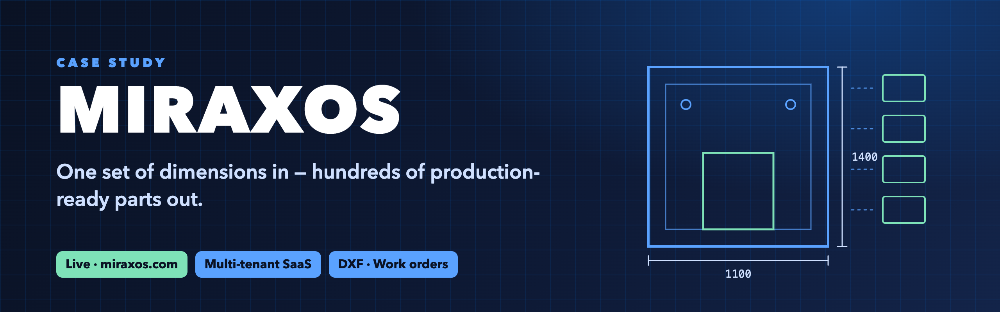
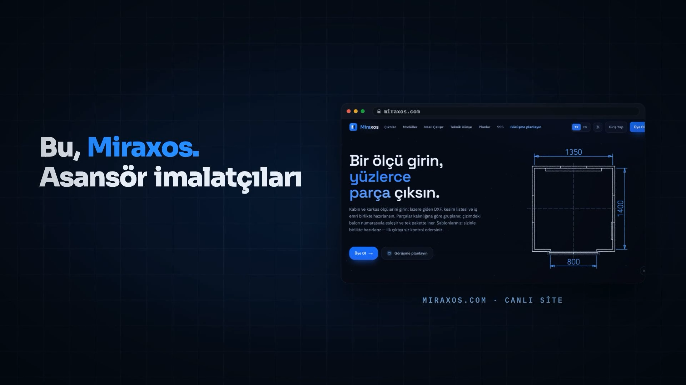
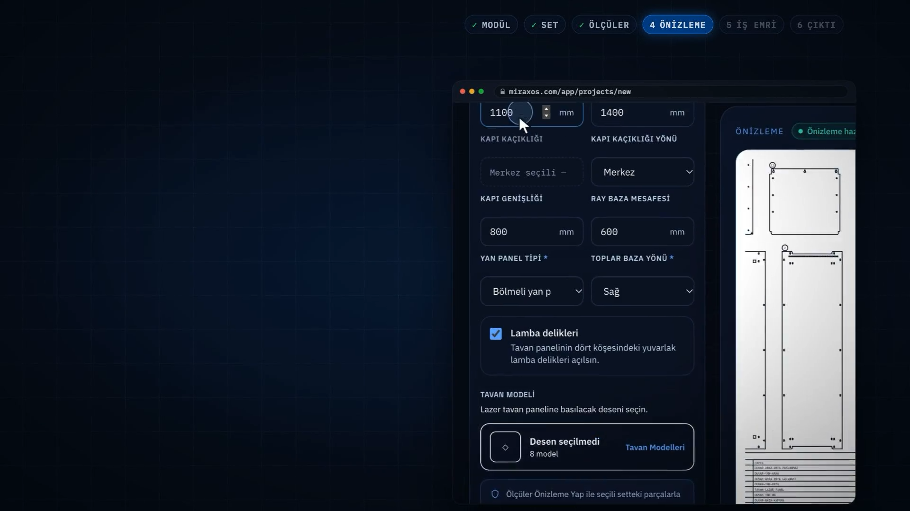
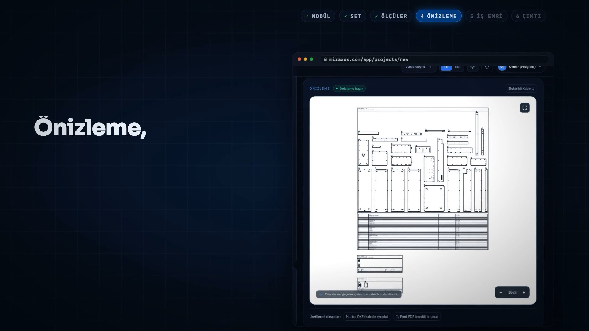
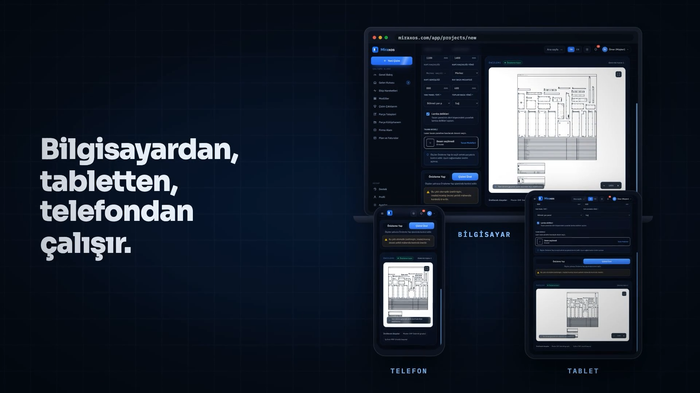
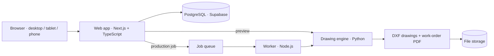

  

# Miraxos

**Miraxos** is a SaaS for elevator cabin manufacturers. Enter the cabin and car-frame dimensions — Miraxos generates the
laser-ready DXF part drawings and the work order together, in a single package.
It is live at **[miraxos.com](https://miraxos.com)** and used in production by manufacturers in Türkiye.

> Miraxos is a commercial, closed-source product. This repository contains no source code — only this overview.

---

## 👤 My role

**Founder & product builder.**

- Product vision, roadmap and priorities
- Domain model of cabin and car-frame parts, built together with a mechanical-engineering partner
- Architecture and quality decisions — what "done" means, how every change is verified before release
- Customer onboarding: preparing each manufacturer's templates and validating the first outputs with them
- Release management: staging → production

---

## 🎬 See it in action

<table>
  <tr>
    <td width="50%" valign="top">
      
      
<b>Product demo</b> (64 s, Turkish) — module → set → dimensions → preview → work order → download

    </td>
    <td width="50%" valign="top">
      
      
<b>1100 × 1400</b> (22 s, Turkish) — one set of dimensions, a full set of parts

    </td>
  </tr>
</table>

---

## ⚙️ How it works

1. **Choose a module** — car frames and cabins from a single catalog (e.g. 1-1 suspension, 2-1 side/rear counterweight, electric cabin)
2. **Choose the production set** — the manufacturer's own parts, approved by their engineer
3. **Enter the dimensions** — cabin width/depth, rail distances, door and panel options
4. **Preview** — the drawing is generated live; if a dimension can't be produced, Miraxos tells you the valid range instead of failing
5. **Download** — one ZIP with laser-ready DXF files and a work-order PDF: parts grouped by thickness, matched to balloon numbers on the drawing

---

## ✨ Product highlights

| | |
|---|---|
| **Company-specific catalogs** | Parts and ceiling patterns belong to one manufacturer; a catalog is never visible to another company |
| **Engineer approval** | Every uploaded DXF part is reviewed; an unapproved part can't appear in any set |
| **Publishing gate** | A set is actually produced with trial dimensions before it can go live — a set that can't be produced isn't published |
| **Range suggestions** | When dimensions don't fit, the user gets the valid ranges, not just an error |
| **No installation** | Runs in the browser — desktop, tablet and phone; no CAD license or powerful computer needed |
| **12+ drawing modules** | 5 active today, 7 more opened on customer request |

**Results reported on miraxos.com:** ~95 % less drawing time · under 2 minutes average output time.

---

## 🏗️ Engineering

**Numbers (measured October 2026)**

- **19,000+ automated tests** — including golden-file regression tests that compare generated drawings against approved reference outputs
- **338 database migrations**, each verified on a local copy before it reaches staging and production
- **1,600+ commits** since July 2026

**Practices**

- Multi-tenant by design — each manufacturer's data, parts and catalog are kept separate
- Safeguards are verified by *deliberately breaking them*: a protection only counts once the test that guards it is seen failing
- Staging → production release pipeline, error tracking and uptime monitoring
- Screens checked on 6 screen sizes × light and dark themes; customer-facing UI in Turkish and English

---

### 📫 Contact

Interested in Miraxos for your production? **[miraxos.com](https://miraxos.com)** · [omerarkbua01@gmail.com](mailto:omerarkbua01@gmail.com)
